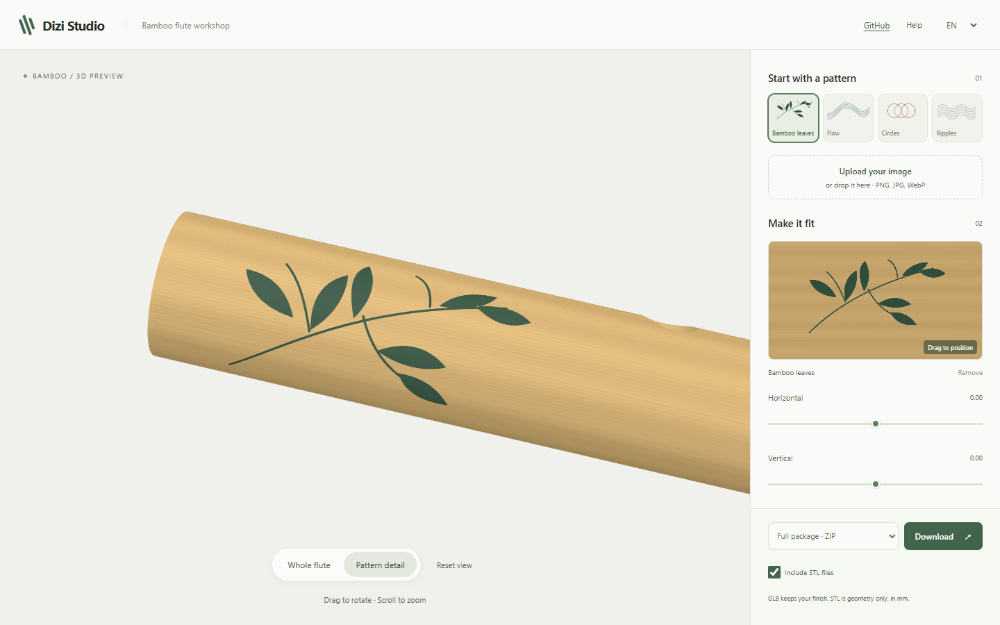

# Bamboo Flute Customizer · 竹笛定制工具

An interactive 3D workshop for viewing a bamboo flute, trying four original
pattern presets or uploading an image, and downloading the resulting models.
The interface is available in English and Chinese.

[Open Dizi Studio](https://qiuxue-yee.github.io/bamboo-flute-customizer/)



一个用于查看竹笛、调整图案位置并导出模型的三维工具，支持中英文界面。

## Run locally · 本地运行

Use Node.js 22.12+ on the 22.x release line, Node.js 24, or Node.js 26+.

```sh
npm ci
npm start
```

Open <http://127.0.0.1:9999>. `npm run dev` starts the same development
server. `npm run build` produces a static site in `dist/`, and
`npm run preview` serves that build locally. Three.js and its companion
loaders/exporters are pinned to version 0.128.0 and supplied locally.

在支持的 Node.js 环境下运行以上命令，然后访问本地地址。
`npm run build` 生成可部署的静态文件。

## Use · 使用

- Drag the model to rotate, scroll to zoom, and right-drag to pan. Focus the
  3D view to rotate with arrow keys or WASD. On touchscreens, drag to
  rotate and pinch to zoom. **Reset view** restores the initial camera.
- Choose a PNG, JPEG or WebP image up to 5 MB. Adjust its horizontal and
  vertical position, reset, clear, undo or redo. The layout and the exported
  GLB use the same composed texture. Images stay in the current browser
  session; they are not uploaded to a server or saved after reload.
- The language selector remembers English or Chinese locally.
- **Whole flute / Pattern detail** switches the view. Selecting a preset or
  uploading an image focuses the pattern area once; editing position preserves
  the camera. Reduced-motion preferences disable the 300 ms transition.
- Drag directly in the layout to place a pattern, or use the arrow keys while
  the layout is focused. A single drag creates one undo step. File drag-and-drop
  uses the same upload validation as the file picker.
- Bamboo finish maps are generated locally and embedded in GLB exports. The
  same physical grain field is used on the body and beneath transparent images.

拖动模型旋转、滚轮缩放、右键拖动平移；触屏可拖动和双指缩放。上传不超过
5 MB 的 PNG、JPEG 或 WebP 图片，使用位置滑块调整。图片只保留在当前浏览器
会话中，不会上传到服务器，也不会在刷新后保存。

## Export · 导出

| Format | Contents | Coordinate convention |
| --- | --- | --- |
| GLB | Customized third part, including the image texture | metres |
| STL | Third part geometry only; no image or color | numeric millimetres |
| ZIP | GLB files for all three parts, optional STL files and a file list | as above |

The original model coordinates are assumed to be millimetres. The application
converts them to metres once when loading, and converts the STL export copy
back to millimetres. STL has no built-in unit metadata; select millimetres in
the receiving software.

原模型数值暂按毫米解释。GLB 使用米；STL 没有单位元数据，本工具输出的 STL
数值按毫米理解。物理装配、打印效果和演奏音准尚未经过实测，请参阅
[模型检查报告](docs/model-report.md)。

## Verification · 验证

```sh
npm test
npm run test:e2e
npm run build
npx playwright test -c playwright.production.config.js
```

The Playwright tests use the installed Chrome on Windows when available.
Elsewhere, install Playwright Chromium with `npx playwright install chromium`
or set `PLAYWRIGHT_CHROMIUM_EXECUTABLE_PATH`. The browser tests create
screenshots, a directional PNG and exported GLB/STL examples in
`output/playwright/`.

The production check serves the built site under its GitHub Pages project path.
The Pages workflow runs all checks before deploying the static build.

Blender 5.2 was used for the current model checks. With Blender on the PATH:

```sh
blender --background --factory-startup --python-exit-code 1 --python scripts/inspect_models.py
blender --background --factory-startup --python-exit-code 1 --python scripts/check_assembly.py
blender --background --factory-startup --python-exit-code 1 --python scripts/calibrate_pattern_uv.py
blender --background --factory-startup --python-exit-code 1 --python scripts/verify_calibration.py
npm run test:e2e
blender --background --factory-startup --python-exit-code 1 --python scripts/verify_export_roundtrip.py
blender --background --factory-startup --python-exit-code 1 --python scripts/render_uv_comparison.py
blender --background --factory-startup --python-exit-code 1 --python scripts/render_export_preview.py
```

Blender work files and machine-readable reports are saved in `output/blender/`.
The four original GLBs remain in `assets/`; only the two UV-calibrated copies
in `assets/generated/` are generated by the calibration script.

## License

MIT. See [LICENSE](LICENSE).
